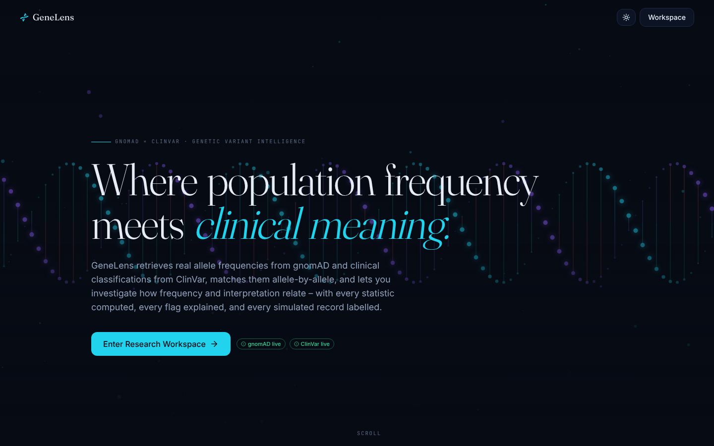
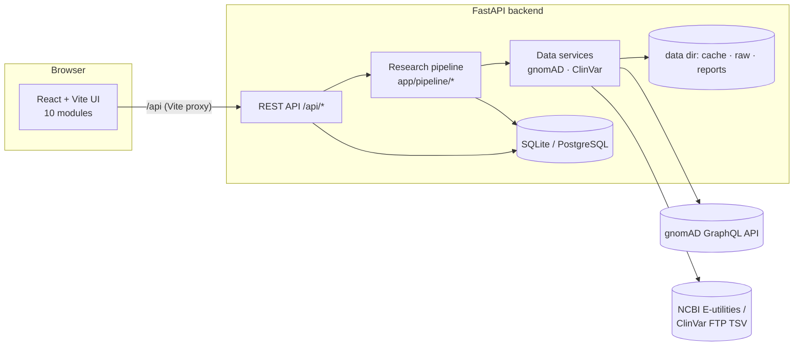
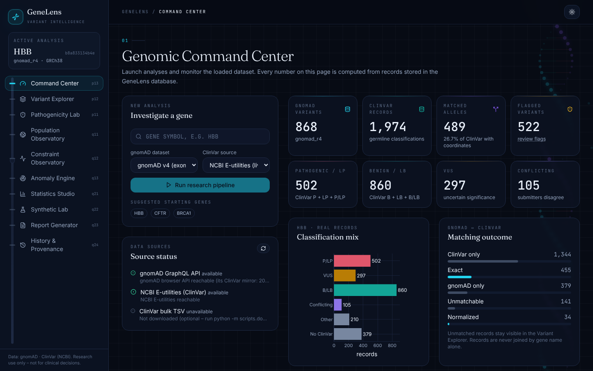
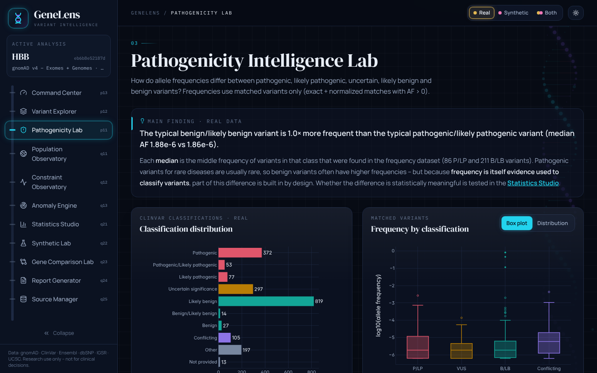
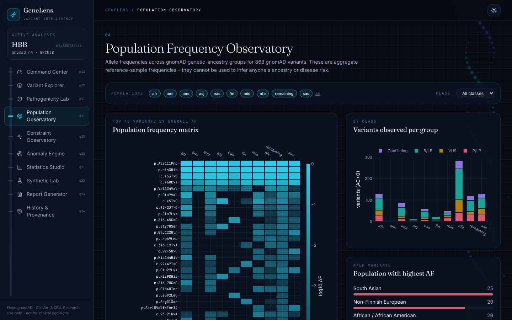
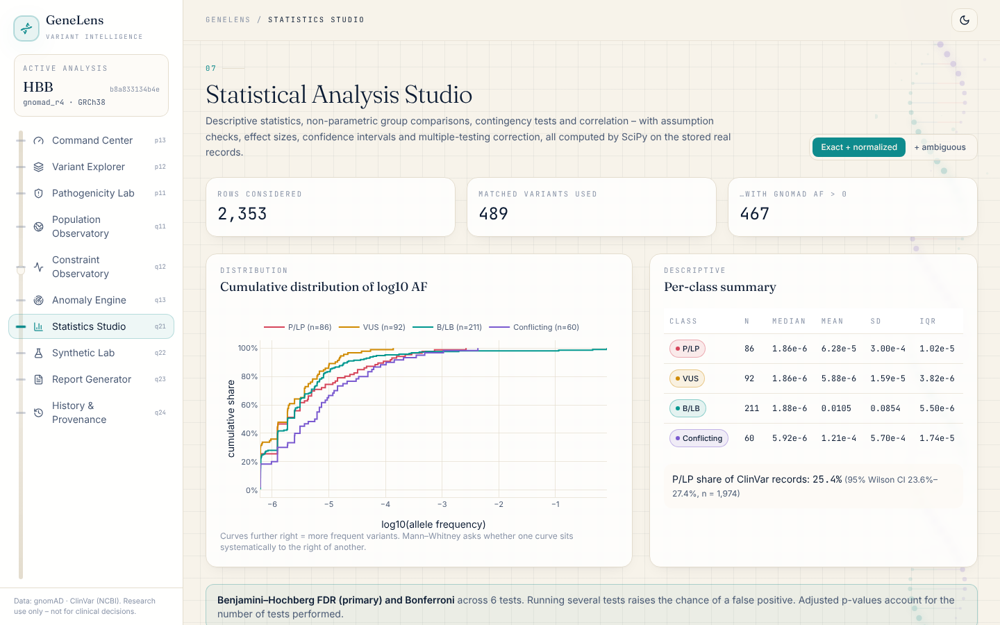
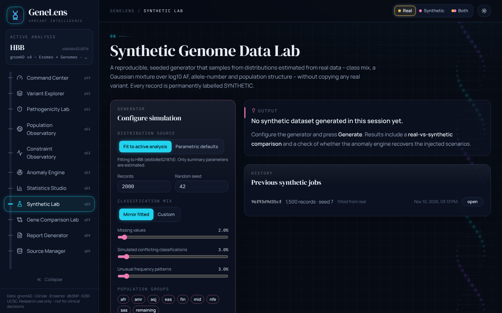

# GeneLens – Genetic Variant Intelligence Platform

> An interactive research platform that integrates **gnomAD** population allele frequencies with **ClinVar** clinical classifications to study how frequency and clinical interpretation relate – with explainable anomaly screening, rigorous statistics, a provenance-labelled synthetic data lab and downloadable research reports.



> ⚠️ **Research and education only.** GeneLens is not a medical device and must not be used for diagnosis, screening or clinical decision-making. Flags are prompts for expert review, never verdicts.

---

## Table of contents
1. [Introduction](#1-introduction)
2. [Research problem](#2-research-problem)
3. [Research objectives](#3-research-objectives)
4. [Features – the ten modules](#4-features--the-ten-modules)
5. [Technology stack](#5-technology-stack)
6. [Architecture](#6-architecture)
7. [Data sources](#7-data-sources)
8. [Dataset acquisition](#8-dataset-acquisition)
9. [Installation](#9-installation)
10. [Running the application](#10-running-the-application)
11. [Statistical methodology](#11-statistical-methodology)
12. [Synthetic data methodology](#12-synthetic-data-methodology)
13. [Screenshots](#13-screenshots)
14. [API documentation](#14-api-documentation)
15. [Testing](#15-testing)
16. [Limitations](#16-limitations)
17. [Future enhancements](#17-future-enhancements)
18. [References and data attribution](#18-references-and-data-attribution)

---

## 1. Introduction
GeneLens retrieves **real** variant data for a gene of your choice:

* **gnomAD** (Genome Aggregation Database): allele counts (AC), allele numbers (AN) and frequencies (AF), overall and per genetic-ancestry group, plus gene-level constraint metrics (pLI, LOEUF, observed/expected counts).
* **ClinVar** (NCBI): clinical significance, review status, conditions and submission counts.

It then validates, normalises and **matches the two databases allele by allele** (never by gene name), stores everything in a SQL database with full provenance, and gives you ten research modules to explore the result.

## 2. Research problem
A variant classified as *pathogenic* for a rare Mendelian disease is usually rare in the general population. When a pathogenic variant is common – or a *benign* one is extremely rare – the combination deserves attention. Possible explanations include **biology** (recessive carrier frequency, reduced penetrance, founder effects, balancing selection such as the sickle-cell allele), **data quality** (low coverage, failed QC filters, incomplete records, ambiguous matching) or an **interpretation that merits review**. Telling these apart requires integrated data, careful matching and transparent statistics.

## 3. Research objectives
1. Retrieve real gnomAD and ClinVar data for a gene with full provenance (source, release, genome build, retrieval date).
2. Clean, validate and normalise variant representations, including indels.
3. Match records between databases using genomic coordinates and alleles; report exact, normalised, ambiguous and unmatched records separately.
4. Compare allele frequencies across P, LP, VUS, LB and B classifications with appropriate non-parametric statistics, effect sizes, confidence intervals and multiple-testing correction.
5. Screen for unusual frequency–classification combinations with explainable rules and statistical outlier detection, separating data-quality issues from biologically interesting observations.
6. Describe population-level frequency patterns and gene constraint without inferring individual risk.
7. Generate clearly labelled synthetic datasets from estimated distributions and use them to evaluate the screening engine.
8. Produce reproducible, downloadable reports.

## 4. Features – the ten modules
| # | Module | What it does |
|---|--------|--------------|
| 01 | **Genomic Command Center** | Gene search (gnomAD autocomplete), dataset/source selection, live data-source status, pipeline progress, counts (variants, matched, P/LP, B/LB, VUS, conflicting, flagged), dataset provenance table, real vs synthetic breakdown, recent analyses. |
| 02 | **Variant Explorer** | Server-side search, filters (class, match status, provenance, AF range, flagged), sorting, pagination, detail drawer (population chart, flags, links to gnomAD/ClinVar), CSV export. |
| 03 | **Pathogenicity Intelligence Lab** | Fine-grained classification distribution, log-AF box plots and distributions, descriptive table, review stars by class, conflicting interpretations, explainable unusual-combination flags. |
| 04 | **Population Frequency Observatory** | Population × variant AF heatmap, variants per group by class, grpmax distribution for P/LP variants, missing-AN indicators, population and class filters, comparison tables. |
| 05 | **Gene Constraint Observatory** | pLI / LOEUF / missense-Z scales, o/e ratios with 90 % CIs, observed vs expected counts, multi-gene LOEUF comparison, metric explanations and caveats. |
| 06 | **Variant Anomaly Detection Engine** | Configurable rules, robust MAD outliers, seeded Isolation Forest; each flag has a category, kind (data quality / biological interest / statistical outlier), priority, evidence and explanation. |
| 07 | **Statistical Analysis Studio** | Descriptives, ECDFs, Mann–Whitney U, chi-square, Fisher's exact, Spearman, Wilson CI, effect sizes with CIs, assumption checks, BH-FDR + Bonferroni, beginner explanations. |
| 08 | **Synthetic Genome Data Lab** | Seeded generator fitted to real distributions; class mix, missingness, conflicts, unusual patterns, populations; real-vs-synthetic comparison (KS, TVD); anomaly-engine recovery check; CSV export. |
| 09 | **Research Report Generator** | PDF (ReportLab + Matplotlib/Seaborn charts) and CSV reports with methodology, statistics, flags, limitations, citations and disclaimer. |
| 10 | **Research History & Provenance** | Timeline of analyses with parameters, dataset releases, retrieval dates, record counts, exports and synthetic jobs; reopen or delete. |

Plus an animated landing page (canvas DNA double helix, molecular particles, scroll transitions), persistent light/dark themes, reduced-motion support and responsive layouts.

## 5. Technology stack
| Layer | Technologies |
|-------|--------------|
| Frontend | React 18, TypeScript 5, Vite 5, Tailwind CSS 3, Framer Motion 11, Plotly.js (cartesian bundle) via react-plotly.js, Lucide icons, React Router 6 |
| Backend | Python 3.11+ (tested on 3.13; CI on 3.12), FastAPI, Pydantic v2, Uvicorn, httpx |
| Science | pandas, NumPy, SciPy, scikit-learn, Matplotlib, Seaborn |
| Data | SQLAlchemy 2.0 ORM, SQLite by default (PostgreSQL-ready), Alembic migrations |
| Reports | ReportLab |
| Testing | pytest, FastAPI TestClient |

**Why no Biopython?** GeneLens never parses sequence files. It works with VCF-style coordinates and canonical SPDI strings, which are simpler to handle directly, so Biopython would be an unused dependency.

## 6. Architecture


Pipeline stages (each a separate, independently tested module in `backend/app/pipeline/`):

```
collection → validation → preprocessing → normalization → gnomAD–ClinVar matching
→ statistics → anomaly screening → visualization data → interpretation → report
```

See [docs/architecture.md](docs/architecture.md) for the full design, folder structure and data model.

## 7. Data sources
| Source | Access | What GeneLens uses |
|--------|--------|-------------------|
| gnomAD browser GraphQL API (`gnomad.broadinstitute.org/api`) | Live, cached on disk | `gene.variants(dataset)`: AC/AN/AF (exome, genome, joint), populations, filters, consequence, HGVS; `gene.gnomad_constraint` |
| NCBI E-utilities (`esearch` + `esummary`, db=clinvar) | Live, cached | Variation ID, allele (measure) ID, canonical SPDI, germline classification, review status, conditions, submissions |
| ClinVar `variant_summary.txt.gz` (NCBI FTP) | Optional bulk download (~450 MB) | Same fields with VCF-normalised positions; required for GRCh37 analyses |

The gnomAD fields were verified against the live schema by introspection (`python -m scripts.inspect_gnomad_schema`). Details, releases and licensing notes are in [docs/data_sources.md](docs/data_sources.md).

## 8. Dataset acquisition
* **Default: nothing to download.** Running an analysis fetches gnomAD and ClinVar data for the chosen gene live and caches the responses in `backend/data/cache/`.
* **Optional bulk ClinVar TSV** (needed for gnomAD v2.1 / GRCh37 analyses, or for fully offline ClinVar):
  ```bash
  python -m scripts.download_clinvar
  ```
  Run it inside `backend/`, then choose *ClinVar source → variant_summary TSV* in the Command Center.
* **Offline snapshots.** The repository ships a real snapshot for **HBB** (retrieved 2026-11-10). It is used *only* if a live API is unreachable, and the dataset is then labelled `offline_snapshot` everywhere. Create your own with `python -m scripts.create_snapshot --gene CFTR`.

## 9. Installation
You need **Python 3.11 or newer**, **Node.js 18 or newer** (20 LTS recommended) and **Git**. Check your versions:
```bash
python --version
```
```bash
node --version
```

### Step 1 – clone
The repository name ends with a dot, which Windows does not allow as a folder name, so clone into a folder called `GeneLens`:
```bash
git clone https://github.com/priyanxhii23/GeneLens-Genetic-Variant-Intelligence-Platform. GeneLens
```
```bash
cd GeneLens
```

### Step 2 – backend (Python)
```bash
cd backend
```
Create a virtual environment (an isolated folder for this project's Python packages):
```bash
python -m venv .venv
```
Activate it on **macOS / Linux**:
```bash
source .venv/bin/activate
```
or on **Windows (PowerShell)**:
```bash
.venv\Scripts\Activate.ps1
```
Install the packages:
```bash
pip install -r requirements.txt
```
Optionally copy the settings template (every setting has a default):
```bash
cp .env.example .env
```

### Step 3 – frontend (Node)
Open a **second terminal** in the project folder:
```bash
cd frontend
```
```bash
npm install
```

## 10. Running the application
**Terminal 1 – backend** (inside `backend/`, virtual environment activated):
```bash
uvicorn app.main:app --reload --port 8000
```
The output ends with `Application startup complete.` Open http://localhost:8000/docs for the interactive API documentation.

**Terminal 2 – frontend** (inside `frontend/`):
```bash
npm run dev
```
Open http://localhost:5173, click **Enter Research Workspace**, type `HBB` and click **Run research pipeline**. HBB takes about 30 seconds on the first run (mostly rate-limited ClinVar retrieval) and about 2 seconds afterwards from cache.

**Command-line pipeline (no web server):**
```bash
python -m scripts.run_pipeline --gene HBB
```

**VS Code:** open the repository folder. Recommended extensions are suggested automatically, and `.vscode/launch.json` contains debug configurations for the API and the CLI pipeline.

### Common errors
| Symptom | Cause / fix |
|---------|-------------|
| `Cannot reach the GeneLens backend` in the UI | The backend isn't running on port 8000. Start terminal 1. |
| `ModuleNotFoundError: No module named 'app'` | Run uvicorn from inside `backend/`. |
| `'uvicorn' is not recognized` / `command not found` | Activate the virtual environment first. |
| PowerShell refuses to run `Activate.ps1` | Run `Set-ExecutionPolicy -Scope CurrentUser RemoteSigned` once. |
| `Address already in use` | Another process uses the port. Start on 8001 and set `VITE_API_TARGET=http://127.0.0.1:8001` in `frontend/.env`. |
| Analysis fails with `gnomAD: … not found` | Use an official HGNC gene symbol (the search box suggests valid ones). |
| Analysis fails with HTTP 429/503 | The public API is rate-limiting or down. GeneLens retries with back-off; wait a minute, use cached data, or add an NCBI API key in `backend/.env`. |
| GRCh37 dataset rejected | gnomAD v2.1/ExAC need the ClinVar TSV (`python -m scripts.download_clinvar`). |

## 11. Statistical methodology
Full detail is in [docs/methodology.md](docs/methodology.md). In brief:

* **Unit of analysis:** one distinct allele. Ambiguous matches are excluded by default (toggle in the Studio); secondary ClinVar records are never double-counted; variants absent from gnomAD are *not* treated as AF = 0.
* **AF = AC / AN**, computed only when AN > 0 and 0 ≤ AC ≤ AN (gnomAD v4 joint exome+genome counts).
* **Descriptives:** n, mean, median, SD, min/max, quartiles and IQR, on AF and log10 AF.
* **Group comparisons:** two-sided Mann–Whitney U on log10 AF for P/LP vs B/LB, P/LP vs VUS and VUS vs B/LB, with rank-biserial correlation and a bootstrap 95 % CI of the median difference. Shapiro–Wilk and Levene tests are reported as assumption checks.
* **Contingency:** chi-square test of classification × AF bin with Cochran's expected-count rule and Cramér's V; Fisher's exact test of P/LP vs B/LB × (AF < 0.1 %) with the conditional odds-ratio CI.
* **Correlation:** Spearman's ρ between log10 AF and ClinVar review stars, with a Fisher-z CI.
* **Proportions:** Wilson score interval.
* **Multiple testing:** Benjamini–Hochberg FDR (primary) and Bonferroni across all tests in a run.
* **Validation:** every statistic is checked in `tests/test_statistics.py` against independent hand calculations (e.g. the exact hypergeometric Fisher p-value, the Yates-corrected chi-square, the exact Mann–Whitney p = 2/252).

## 12. Synthetic data methodology
* **Fit** (from a real analysis, matched variants only): class proportions; a 1–3 component Gaussian mixture over log10 AF per class; a normal model of log10 AN; mean population AN shares; dispersion of population AF around the global AF. Only these summary parameters are stored. No variant, coordinate or identifier is copied (tested).
* **Sample:** class → target AF → AN → Dirichlet split of AN across populations → population AC ~ Binomial(AN, AF·noise). Global AC/AN are sums, so **AF = AC/AN always holds** (tested).
* **Scenarios:** configurable missingness, conflicting labels and unusual frequency patterns, recorded as `simulated_*` QC flags. These serve as ground truth for evaluating the anomaly engine.
* **Labelling:** `provenance = SYNTHETIC`, `SYN-<job>-<n>` IDs, chromosome `SYN`, "(simulated)" classification labels, and no conditions, submitters or review stars. The UI uses hatched violet styling; CSV exports carry a provenance column and a header comment. Synthetic records are stored separately and never enter real-data statistics (tested).
* **Reproducibility:** one seeded NumPy generator per job.
* **Comparison:** per-class KS statistic, overlaid histograms and class-mix total variation distance.

## 13. Screenshots
| | |
|---|---|
|  |  |
|  |  |
|  |  |

All screenshots show real HBB data from gnomAD v4 and ClinVar, retrieved 2026-11-10. The Synthetic Lab shows labelled synthetic records next to the real distribution.

## 14. API documentation
Interactive Swagger UI: **http://localhost:8000/docs** (ReDoc at `/redoc`).

| Method | Path | Purpose |
|--------|------|---------|
| GET | `/api/health` | Service and database health |
| GET | `/api/sources/status` | Live reachability of gnomAD / NCBI, TSV presence |
| GET | `/api/datasets` | Supported gnomAD datasets and genome builds |
| GET | `/api/genes/search?q=` | Gene autocomplete (gnomAD `gene_search`) |
| POST | `/api/analysis/run` | Start an analysis (background task), returns 202 |
| GET | `/api/analysis/{id}/status` | Stage and progress polling |
| GET | `/api/analysis/{id}` | Full stored results and dataset provenance |
| GET | `/api/analysis/statistics?analysis_id=&include_ambiguous=` | Statistics (recomputed if the toggle differs) |
| GET | `/api/analysis/populations?analysis_id=` | Population summary |
| GET | `/api/analysis/constraint?analysis_id=` | Constraint metrics and interpretation |
| GET | `/api/constraint/compare?genes=A,B` | Multi-gene constraint comparison |
| GET | `/api/dashboard?analysis_id=` | Command-center metrics (computed in SQL) |
| GET | `/api/variants` | Search / filter / sort / paginate variants |
| GET | `/api/variants/export` | CSV export of the current filter (logged) |
| GET | `/api/variants/{id}` | Variant detail with flags and links |
| POST | `/api/anomalies/detect` | Re-run screening with new thresholds |
| GET | `/api/anomalies?analysis_id=` | Paginated flags, priority-ordered |
| POST | `/api/synthetic/generate` | Generate a synthetic dataset |
| GET | `/api/synthetic`, `/api/synthetic/{id}` | Synthetic jobs |
| POST | `/api/reports/generate` | PDF or CSV report |
| GET | `/api/reports`, `/api/reports/{id}/download` | Export history and download |
| GET | `/api/history`, `/api/history/{id}` | Saved analyses with provenance |
| DELETE | `/api/history/{id}` | Delete an analysis and its records |

Errors use one JSON shape (`{"detail": …, "type": …}`): 404 not found, 409 not ready, 422 validation or assembly mismatch, 503 external source unavailable.

## 15. Testing
```bash
cd backend
```
```bash
python -m pytest
```
The suite (78 tests at the time of writing) covers:

* data cleaning, AF = AC/AN, missing data and classification normalisation
* SPDI conversion, indel normalisation and matching: exact, normalised, ambiguous, unmatched and unmatchable records, no gene-name joins, assembly mismatch
* every statistical test, against independent calculations
* anomaly categories and thresholds
* synthetic data: reproducibility, internal consistency, labelling and no copying of real records
* service caching and snapshot fallback, and report generation
* a full end-to-end API workflow, including real/synthetic separation

External APIs are replaced by clearly labelled **test fixtures** (`tests/fixtures/sample_data.py`), so the tests run offline.

Frontend type-check and production build:
```bash
cd frontend
```
```bash
npm run build
```
GitHub Actions (`.github/workflows/ci.yml`) runs both on every push.

## 16. Limitations
* ClinVar classifications are submitted assertions of varying quality, not ground truth.
* Frequency is itself ACMG/AMP evidence, so frequency–classification associations are partly circular.
* gnomAD is a reference sample (not disease-free) and under-represents many ancestries.
* Matching without the reference genome relies on both sources being left-aligned; rare complex indels may remain unmatched. Haplotypes and large CNVs are reported as unmatchable.
* Variants within a gene are not fully independent observations.
* The gene-level gnomAD API returns all variants in one response, so very large genes (e.g. *TTN*) take longer and use more memory.
* The synthetic generator reproduces marginal distributions, not linkage, protein structure or functional effects.

## 17. Future enhancements
* Reference-sequence-based left-alignment (e.g. with a local FASTA) for full indel normalisation.
* Regional missense constraint tracks and transcript-level views.
* Multi-gene cohort analyses and gene-set comparisons.
* A Celery/RQ worker for long-running jobs; PostgreSQL deployment with Docker Compose.
* Per-submission (SCV) analysis of ClinVar conflicts.
* User accounts and shareable read-only analysis links.

## 18. References and data attribution
* Chen S, et al. *A genomic mutational constraint map using variation in 76,156 human genomes.* Nature 625, 92–100 (2024).
* Karczewski KJ, et al. *The mutational constraint spectrum quantified from variation in 141,456 humans.* Nature 581, 434–443 (2020).
* Landrum MJ, et al. *ClinVar: improvements to accessing data.* Nucleic Acids Res 48, D835–D844 (2020).
* Richards S, et al. *Standards and guidelines for the interpretation of sequence variants (ACMG/AMP).* Genet Med 17, 405–424 (2015).
* Benjamini Y, Hochberg Y. *Controlling the false discovery rate.* J R Stat Soc B 57, 289–300 (1995).
* Liu FT, Ting KM, Zhou ZH. *Isolation Forest.* ICDM (2008).
* Holmes JB, et al. *SPDI: data model for variants and applications at NCBI.* Bioinformatics 36, 1902–1907 (2020).

gnomAD data comes from the Genome Aggregation Database consortium (Broad Institute); ClinVar data from the National Center for Biotechnology Information. Please cite the data providers in any work that uses GeneLens output. The code is MIT-licensed; see [LICENSE](LICENSE).
