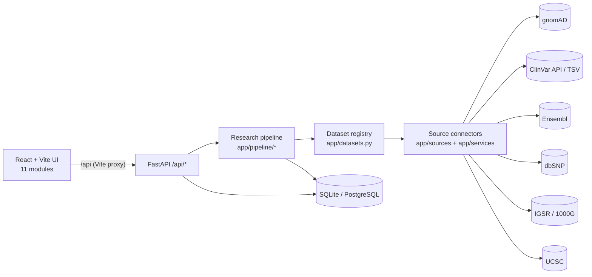
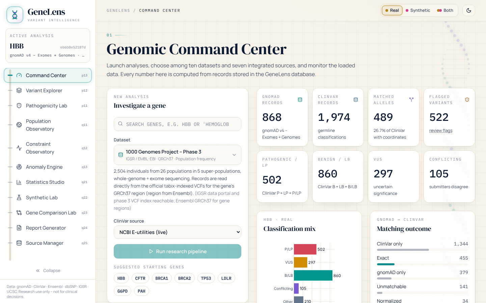
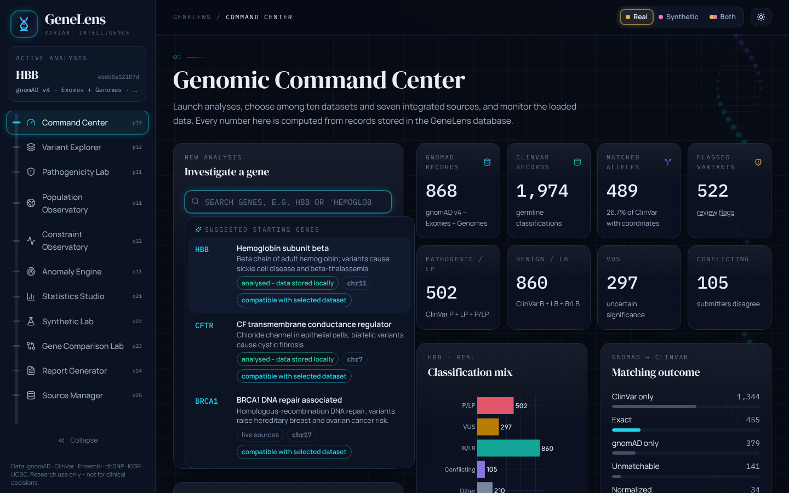
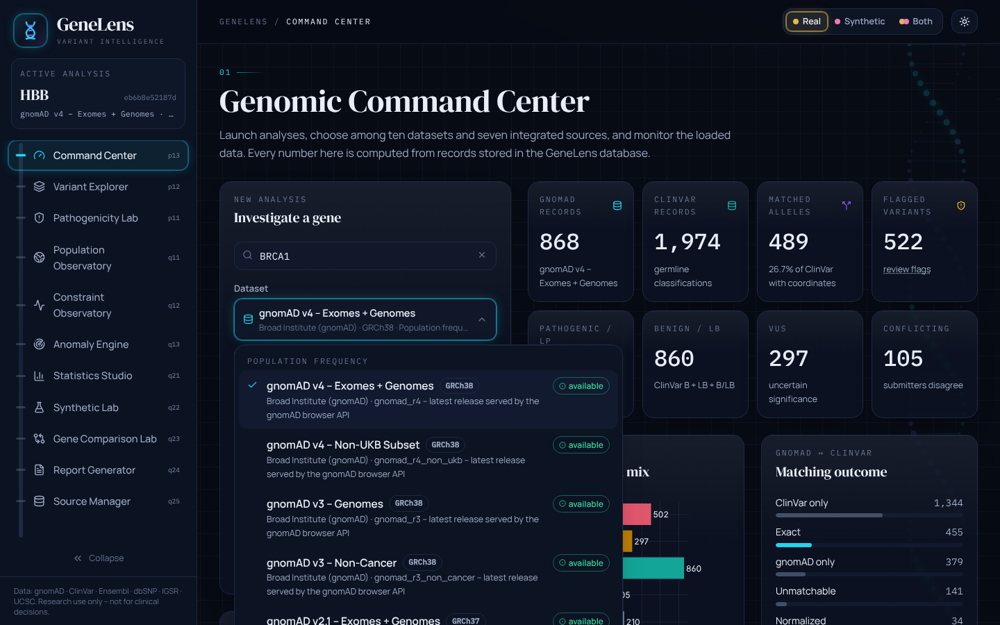
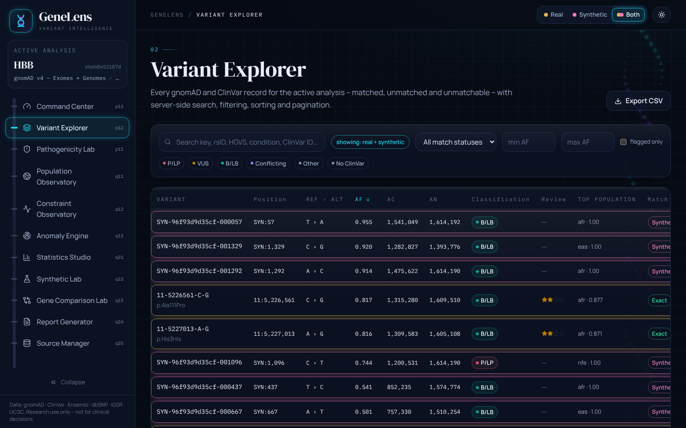
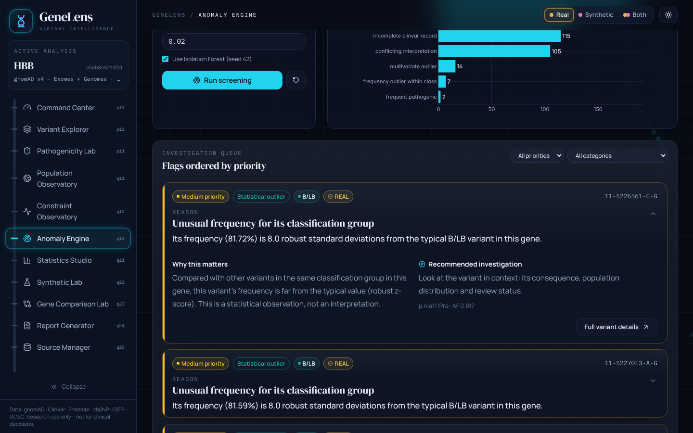
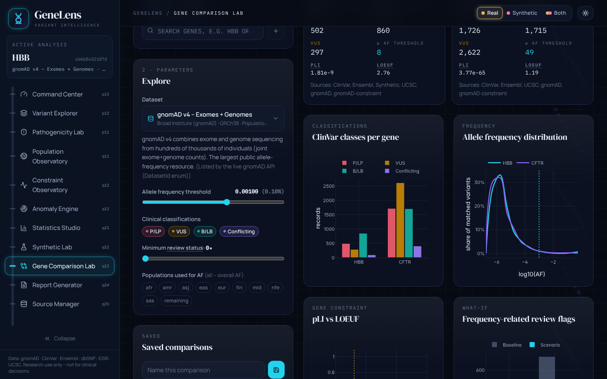
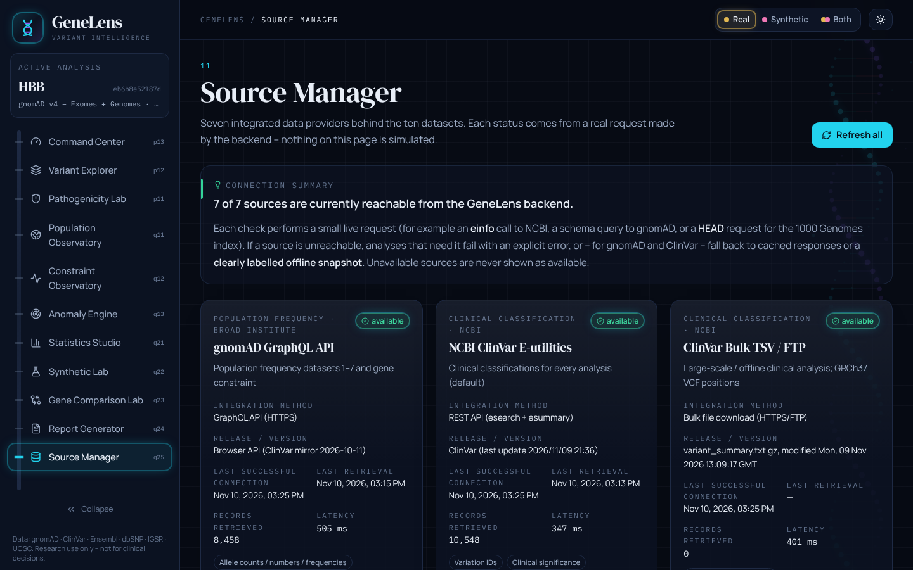

# GeneLens – Genetic Variant Intelligence Platform

> A research platform that integrates **population allele frequencies** (gnomAD, 1000 Genomes, dbSNP) with **ClinVar clinical classifications**, cross-checked against **Ensembl** and **UCSC** – with explainable anomaly screening, rigorous statistics, a provenance-labelled synthetic data lab, a gene comparison lab and downloadable research reports.


> ⚠️ **Research and education only.** GeneLens is not a medical device and must not be used for diagnosis, screening or clinical decision-making. Flags are prompts for expert review, never verdicts.

---

## Table of contents
**Part A – Getting started**
1. [Extract the ZIP](#1-extract-the-zip)
2. [Open it in VS Code](#2-open-it-in-vs-code)
3. [Create the Python virtual environment](#3-create-the-python-virtual-environment)
4. [Install backend dependencies](#4-install-backend-dependencies)
5. [Install frontend dependencies](#5-install-frontend-dependencies)
6. [Configure environment variables](#6-configure-environment-variables)
7. [Run the backend](#7-run-the-backend)
8. [Run the frontend](#8-run-the-frontend)
9. [Access the application](#9-access-the-application)
10. [Troubleshooting](#10-troubleshooting)
11. [Configure and retrieve datasets](#11-configure-and-retrieve-datasets)
12. [Run the tests](#12-run-the-tests)

**Part B – The project**
13. [Research problem & objectives](#13-research-problem--objectives) · 14. [Features](#14-features--eleven-modules) · 15. [Data ecosystem](#15-data-ecosystem--10-datasets-7-sources) · 16. [Technology stack](#16-technology-stack) · 17. [Architecture](#17-architecture) · 18. [Statistical methodology](#18-statistical-methodology) · 19. [Synthetic data methodology](#19-synthetic-data-methodology) · 20. [Screenshots](#20-screenshots) · 21. [API](#21-api-documentation) · 22. [Limitations](#22-limitations) · 23. [Future work](#23-future-enhancements) · 24. [References](#24-references-and-data-attribution)

---

# Part A – Getting started

You need **Python 3.11 or newer** (3.12 recommended), **Node.js 18 or newer** (20 LTS recommended) and **VS Code**. Check your versions in a terminal:
```bash
python --version
```
```bash
node --version
```
On Windows, install Python from python.org and tick **"Add python.exe to PATH"**. Install Node.js LTS from nodejs.org with default options.

## 1. Extract the ZIP
Right-click `GeneLens_Complete_Project.zip` → **Extract All…** (Windows) or double-click it (macOS). You get a folder called **`GeneLens`** containing `backend/`, `frontend/`, `docs/` and this README. A short path without special characters works best, e.g. `C:\Users\<you>\GeneLens` or `~/GeneLens`.

*(Cloning with Git instead? The repository name ends with a dot, which Windows does not allow as a folder name, so clone into a folder called `GeneLens`:)*
```bash
git clone https://github.com/priyanxhii23/GeneLens-Genetic-Variant-Intelligence-Platform. GeneLens
```

## 2. Open it in VS Code
**File → Open Folder…** and choose the **`GeneLens`** folder itself (not `backend` or `frontend`). If asked *"Do you trust the authors?"*, choose **Yes**. Accept the popup to install the **recommended extensions** (Python, Pylance, Python Debugger, Tailwind CSS).

VS Code is pre-configured (`.vscode/`):
* **Ctrl+Shift+B** → *GeneLens: start everything* (backend + frontend in two terminal tabs)
* **Terminal → Run Task…** → *Setup: install everything (first time)*, *Backend: run tests*, *Backend: run pipeline for HBB (CLI)*
* **Run and Debug** (Ctrl+Shift+D) → *GeneLens API (debug)* to set breakpoints in backend code
* **Testing** (beaker icon) → run the backend test suite

The fastest path is **Terminal → Run Task… → Setup: install everything (first time)**, which performs steps 3–5 for you. Then press **Ctrl+Shift+B**. The manual steps follow.

## 3. Create the Python virtual environment
Open a terminal in VS Code (**Terminal → New Terminal**):
```bash
cd backend
```
```bash
python -m venv .venv
```
Activate it – **Windows (PowerShell)**:
```bash
.venv\Scripts\Activate.ps1
```
**macOS / Linux**:
```bash
source .venv/bin/activate
```
Your prompt now starts with `(.venv)`. If PowerShell says running scripts is disabled, run this once, answer `Y`, and activate again:
```bash
Set-ExecutionPolicy -Scope CurrentUser RemoteSigned
```

## 4. Install backend dependencies
With the virtual environment active, inside `backend/`:
```bash
pip install -r requirements.txt
```
This takes a few minutes (pandas, SciPy, scikit-learn, Matplotlib…). It ends with `Successfully installed …`.

## 5. Install frontend dependencies
Open a **second terminal** (the `+` in the terminal panel):
```bash
cd frontend
```
```bash
npm install
```
Takes 1–3 minutes. Yellow warnings are normal.

## 6. Configure environment variables
Optional – GeneLens works without any configuration. To customise, copy the template:
```bash
cp backend/.env.example backend/.env
```
(Windows: `copy backend\.env.example backend\.env`.) Useful settings in `backend/.env`:

| Variable | Purpose |
|---|---|
| `GENELENS_NCBI_API_KEY` | NCBI key – raises E-utilities limit from 3 to 10 requests/s (faster ClinVar & dbSNP). Free at ncbi.nlm.nih.gov/account/settings |
| `GENELENS_DATA_DIR` | Where the database, caches, downloads and reports are stored (default `backend/data`) |
| `GENELENS_DATABASE_URL` | Use PostgreSQL instead of SQLite (`postgresql+psycopg://…`, then `pip install "psycopg[binary]"`) |
| `GENELENS_CACHE_TTL_HOURS` | How long API responses are cached (default 168 = 7 days) |

Secrets stay in `backend/.env`, which is git-ignored and never sent to the browser. `frontend/.env` (optional) only holds `VITE_API_TARGET` if the backend runs on a port other than 8000.

## 7. Run the backend
Terminal 1, inside `backend/`, virtual environment active:
```bash
uvicorn app.main:app --reload --port 8000
```
Ready when it prints `Application startup complete.` (the first start takes 10–20 s while scientific libraries load). Visiting `http://localhost:8000/` shows `404 Not Found` – that is expected; the API lives under `/api` and its documentation at **http://localhost:8000/docs**.

## 8. Run the frontend
Terminal 2, inside `frontend/`:
```bash
npm run dev
```
Ready when it prints `Local: http://localhost:5173/`. Keep **both** terminals open while using GeneLens.

## 9. Access the application
Open **http://localhost:5173** → **Enter Research Workspace**. Click the gene search box – eight suggested genes appear immediately – choose **HBB**, keep the dataset **gnomAD v4 – Exomes + Genomes**, and press **Run research pipeline**. The first HBB run takes about 30–60 s (rate-limited ClinVar retrieval); repeats take seconds from cache.

Then explore the modules in the left sidebar, and use the **Real · Synthetic · Both** switch at the top to change which records every module displays.

## 10. Troubleshooting
| Symptom | Cause / fix |
|---|---|
| UI says *Cannot reach the GeneLens backend* | Terminal 1 is not running, or uvicorn was started outside `backend/`. |
| `ModuleNotFoundError: No module named 'app'` | Run uvicorn from inside `backend/`. |
| `'uvicorn' / 'pip' is not recognized` | Activate the virtual environment first (step 3). |
| PowerShell refuses `Activate.ps1` | `Set-ExecutionPolicy -Scope CurrentUser RemoteSigned`, answer `Y`. |
| `python` / `npm` not recognized | Install Python / Node.js (see top of Part A), then open a **new** terminal. |
| `Address already in use` / port error | Another process uses the port. Stop it, or run uvicorn with `--port 8001` and create `frontend/.env` with `VITE_API_TARGET=http://127.0.0.1:8001`. |
| `git clone` fails with *Invalid argument* (Windows) | Clone into a folder without a trailing dot – see step 1. |
| Ctrl+Shift+B says *No build task* | You opened `backend` or `frontend` instead of the `GeneLens` folder. |
| An analysis fails with *not found* | Use an official gene symbol – the search box suggests valid ones. |
| An analysis fails with HTTP 429 / 503 | A public API is rate-limiting or down. GeneLens retries automatically; check **Source Manager**, wait a minute, or add an NCBI API key. |
| A dataset shows *unavailable* | Its provider could not be reached from your network. Press **Refresh** in the Source Manager; corporate firewalls sometimes block FTP/EBI hosts. |
| Old database after upgrading | Nothing to do – new columns/tables are added automatically at startup. To start fresh, stop the backend and delete `backend/data/genelens.db`. |

## 11. Configure and retrieve datasets
Everything is retrieved **live, per gene**, the first time it is needed, then cached in `backend/data/cache/`. Choose the dataset in the Command Center's **Dataset** selector:

| # | Dataset | Assembly | What is fetched for a gene |
|---|---|---|---|
| 1–4 | gnomAD v4 (exomes+genomes, non-UKB), v3 (genomes, non-cancer) | GRCh38 | all variants with AC/AN/AF + populations (gnomAD GraphQL) |
| 5–7 | gnomAD v2.1 (exomes+genomes, non-cancer), ExAC | GRCh37 | same, older assembly |
| 8 | 1000 Genomes Project – Phase 3 | GRCh37 | records in the gene region read from the official tabix-indexed VCFs (IGSR) |
| 9 | ClinVar Variant Summary – NCBI | GRCh38 | clinical classifications only (no frequencies) |
| 10 | dbSNP RefSNP Dataset – NCBI | GRCh38 | all RefSNPs annotated to the gene with alleles + per-study frequencies |

ClinVar is always retrieved alongside (NCBI E-utilities by default). Optional bulk ClinVar file (~450 MB, for offline or large-scale work):
```bash
python -m scripts.download_clinvar
```
(run inside `backend/` with the venv active), then choose *ClinVar source → variant_summary TSV*.

Other utilities (inside `backend/`):
```bash
python -m scripts.run_pipeline --gene CFTR --dataset gnomad_r4
```
```bash
python -m scripts.create_snapshot --gene CFTR
```
```bash
python -m scripts.inspect_gnomad_schema
```
The repository ships a real **offline snapshot for HBB** (gnomAD v4 + ClinVar, retrieved 2026-11-10), used only if those APIs are unreachable and always labelled `offline snapshot`.

## 12. Run the tests
**Backend** (100 tests – data cleaning, AF = AC/AN, matching, statistics validated against hand calculations, anomaly engine, synthetic generator, connectors, tabix reader, provenance separation, comparison lab, API):
```bash
cd backend
```
```bash
python -m pytest
```
**Frontend** type-check + production build:
```bash
cd frontend
```
```bash
npm run build
```
**End-to-end acceptance checks** (optional, 53 browser checks – gene search, datasets, real/synthetic modes, explanations, anomaly cards, comparison lab, themes, responsiveness). With both servers running and an HBB + CFTR gnomAD v4 analysis plus one synthetic job created:
```bash
npm i -D playwright && npx playwright install chromium
```
```bash
node e2e/smoke.cjs <HBB-analysis-id>
```

---

# Part B – The project

## 13. Research problem & objectives
A variant classified as *pathogenic* for a rare Mendelian disease is usually rare in the general population. When a pathogenic variant is common – or a *benign* one is extremely rare – the combination deserves attention. Explanations include **biology** (recessive carrier frequency, reduced penetrance, founder effects, balancing selection such as the sickle-cell allele), **data quality** (low coverage, failed filters, incomplete records, ambiguous matching) or an **interpretation that merits review**.

Objectives: retrieve real data with full provenance; normalise and match records allele by allele (never by gene name); compare frequencies across P / LP / VUS / LB / B with appropriate statistics; screen for unusual combinations with explainable rules, separating data-quality issues from biologically interesting observations; describe population frequencies and gene constraint without inferring individual risk; generate clearly labelled synthetic data to evaluate the screening engine; compare genes and screening scenarios; produce reproducible reports.

## 14. Features – eleven modules
| # | Module | Highlights |
|---|---|---|
| 01 | **Genomic Command Center** | Gene search with suggestions before typing, 10-dataset picker, 7-source status, provenance-aware metrics, gene annotation cross-check (gnomAD / Ensembl / UCSC), recent analyses (open / delete) |
| 02 | **Variant Explorer** | Server-side search / filter / sort / pagination; Real · Synthetic · Both modes (gold/pink outlines in Both); detail drawer with on-demand **Ensembl VEP** and **dbSNP** annotation; CSV export |
| 03 | **Pathogenicity Intelligence Lab** | Classification distribution, log-AF box plots & distributions, descriptive tables, review stars, conflicts, unusual-combination flags |
| 04 | **Population Observatory** | Population × variant heatmap, per-group counts by class, grpmax, missing-AN indicators, filters |
| 05 | **Gene Constraint Observatory** | pLI / LOEUF / missense-Z, o/e with CIs, multi-gene LOEUF comparison |
| 06 | **Anomaly Detection Engine** | Rules + robust outliers + Isolation Forest; cards with reason, why it matters and recommended investigation |
| 07 | **Statistics Studio** | Mann–Whitney, chi-square, Fisher, Spearman, Wilson CI, effect sizes, assumption checks, BH-FDR; real and synthetic computed separately |
| 08 | **Synthetic Data Lab** | Seeded generator fitted to real distributions, scenario injection, real-vs-synthetic comparison, anomaly-engine recovery check |
| 09 | **Gene Comparison Lab** | 2–5 genes side by side; AF threshold, classes, minimum review stars, population selection; what-if screening (previous / updated / difference / % change); save, reopen, export, download charts |
| 10 | **Report Generator** | PDF & CSV reports; analysis history & full provenance (parameters, releases, retrieval dates, exports) |
| 11 | **Source Manager** | Seven live connectors with method, availability, release, last connection, last retrieval, records retrieved, errors, refresh; dataset registry table |

Every module has a prominent **main reason** explanation and a **"How to read this"** guide with bold terms and glossary tooltips. Light and dark themes persist; the sidebar collapses; layouts adapt from phones to wide desktops; reduced-motion is respected.

## 15. Data ecosystem – 10 datasets, 7 sources
**Sources** (`backend/app/sources/registry.py`, each with a real `probe()` and persisted statistics):

| Source | Integration | Used for |
|---|---|---|
| gnomAD GraphQL API | GraphQL over HTTPS | datasets 1–7, gene constraint, gene search |
| NCBI ClinVar E-utilities | esearch + esummary | clinical classifications (default); GRCh37 via ClinVar's own GRCh37 locations |
| ClinVar Bulk TSV / FTP | `variant_summary.txt.gz` | offline / large-scale clinical analysis |
| Ensembl REST API | REST (GRCh38 + GRCh37 servers) | gene identifiers, coordinates, canonical transcripts, VEP annotation |
| NCBI dbSNP / Variation API | E-utilities `db=snp` + Variation Services | dataset 10, RefSNP details in the variant drawer |
| International Genome Sample Resource | data-portal API + tabix range requests | dataset 8 (1000 Genomes phase 3), population metadata |
| UCSC Genome Browser API | REST | assembly info, RefSeq gene coordinates, cytoband |

Every dataset's availability is checked against its live provider (e.g. the gnomAD `DatasetId` enum is introspected). Assemblies are never mixed: ClinVar records are converted to GRCh37 using ClinVar's own GRCh37 location, and records without one are kept as *unmatchable* rather than guessed. Details: [docs/data_sources.md](docs/data_sources.md).

## 16. Technology stack
| Layer | Technologies |
|---|---|
| Frontend | React 18, TypeScript 5, Vite 5, Tailwind CSS 3, Framer Motion 11, Plotly.js (cartesian bundle), Lucide, React Router 6 |
| Typography | DM Serif Display (headings), Manrope (body), IBM Plex Mono (identifiers) |
| Backend | Python 3.11+, FastAPI, Pydantic v2, Uvicorn, httpx |
| Science | pandas, NumPy, SciPy, scikit-learn, Matplotlib, Seaborn |
| Data | SQLAlchemy 2.0, SQLite (PostgreSQL-ready), Alembic migrations + automatic column upgrade |
| Reports | ReportLab |
| Testing | pytest, FastAPI TestClient, Playwright (e2e) |

A small pure-Python **tabix/BGZF reader** (`app/services/tabix.py`) reads gene regions from remote 1000 Genomes VCFs without native dependencies, so it works on Windows. Biopython is not needed because GeneLens works with coordinates and SPDI strings, not sequence files.

## 17. Architecture

```
collection → validation → preprocessing → normalisation → matching → statistics
→ anomaly screening → visualisation data → interpretation → report
```
Full design, folder structure and data model: [docs/architecture.md](docs/architecture.md).

## 18. Statistical methodology
One distinct allele per observation; ambiguous matches excluded by default; variants absent from the frequency dataset are not AF = 0. AF = AC / AN only when AN > 0 and 0 ≤ AC ≤ AN. Mann–Whitney U on log10 AF (rank-biserial r, bootstrap CI of the median difference), chi-square (Cochran rule, Cramér's V), Fisher's exact (conditional OR CI), Spearman (Fisher-z CI), Wilson CI, Benjamini–Hochberg FDR + Bonferroni. Real and synthetic data are always computed separately. Every method is validated against independent calculations in `tests/test_statistics.py`. See [docs/methodology.md](docs/methodology.md).

## 19. Synthetic data methodology
Fit summary distributions from real matched variants (class mix, Gaussian mixture over log10 AF per class, AN model, population shares and dispersion – no records copied); sample populations with Binomial counts so AF = AC/AN always holds; optionally inject missingness, conflicts and unusual frequencies as ground truth; label permanently (`SYNTHETIC`, `SYN-` IDs, chromosome `SYN`, no fabricated clinical evidence); seeded and reproducible; compared to real data with KS statistics and total variation distance.

## 20. Screenshots
| | |
|---|---|
|  |  |
|  |  |
|  |  |
|  |  |
|  |  |

All screenshots show real data (HBB / CFTR, gnomAD v4 + ClinVar, retrieved 2026-11-10) except records explicitly labelled SYNTHETIC.

## 21. API documentation
Interactive docs: **http://localhost:8000/docs**. Main endpoints:

| Method | Path | Purpose |
|---|---|---|
| GET | `/api/health` | Health |
| GET | `/api/sources` · POST `/api/sources/{id}/refresh` | Seven connectors with live status + statistics |
| GET | `/api/sources/status` | Compact gnomAD/ClinVar status (landing page) |
| GET | `/api/datasets` | Ten-dataset registry with live availability |
| GET | `/api/genes/suggest?q=` · `/api/genes/search?q=` | Gene suggestions (8 starters, catalogue, live search) |
| POST | `/api/analysis/run` | Start an analysis (any of the 10 datasets) |
| GET | `/api/analysis/{id}` · `/status` | Results / progress |
| GET | `/api/analysis/statistics?analysis_id=&provenance=` | Statistics; with `provenance` returns `{mode, groups}` |
| GET | `/api/analysis/populations?analysis_id=&provenance=` | Population summary (same shape rule) |
| GET | `/api/analysis/constraint` · `/api/constraint/compare` | Constraint |
| GET | `/api/dashboard?analysis_id=&provenance=` | Command-center metrics per provenance group |
| GET | `/api/variants?provenance=REAL|SYNTHETIC|BOTH` · `/export` · `/{id}` · `/{id}/annotation` | Explorer, CSV, detail, live VEP + dbSNP |
| POST/GET | `/api/anomalies/detect` · `/api/anomalies?provenance=` | Screening; flags with headline, reason, why it matters, recommendation |
| POST/GET | `/api/synthetic/generate` · `/api/synthetic` | Synthetic data |
| POST | `/api/compare/run` · `/api/compare/whatif` | Gene comparison and what-if |
| POST/GET/DELETE | `/api/compare/saved` · `/{id}` · `/{id}/export` | Saved comparisons |
| POST/GET | `/api/reports/generate` · `/api/reports` · `/{id}/download` | Reports |
| GET/DELETE | `/api/history` · `/api/history/{id}` | Analysis history & provenance |

**API changes in this version** (backward compatible): `/api/datasets` now returns the full registry objects; `statistics`, `populations`, `dashboard`, `anomalies` and `variants` accept `provenance` (old calls without it behave as before); anomaly items include `headline`, `reason`, `why_it_matters`, `recommendation`; GRCh37 datasets now accept `clinvar_source=eutils`.

## 22. Limitations
* ClinVar classifications are submitted assertions, not ground truth; frequency is itself ACMG/AMP evidence, so frequency–classification associations are partly circular.
* Reference datasets (gnomAD, 1000 Genomes) under-represent many ancestries and are not disease-free.
* Matching relies on both sources being left-aligned (no reference FASTA); haplotypes, large CNVs and IUPAC-ambiguous alleles are reported as unmatchable.
* 1000 Genomes population AC is derived as AF × AN (phase 3 genotypes are complete); dbSNP allele numbers are derived from study count ÷ frequency – both are flagged on every record.
* dbSNP retrieval is capped at 25,000 RefSNPs per gene; very large genes take minutes without an NCBI API key.
* Third-party APIs can rate-limit or change; GeneLens reports this honestly in the Source Manager. All connectors were tested live on 2026-11-10.
* Synthetic data reproduces marginal distributions only, not linkage or function.

## 23. Future enhancements
Reference-FASTA left-alignment; regional missense constraint; per-submission (SCV) ClinVar conflict analysis; Docker Compose with PostgreSQL and a job queue; Playwright tests in CI.

## 24. References and data attribution
* Chen S, et al. *A genomic mutational constraint map using variation in 76,156 human genomes.* Nature 625, 92–100 (2024).
* Karczewski KJ, et al. *The mutational constraint spectrum quantified from variation in 141,456 humans.* Nature 581, 434–443 (2020).
* Landrum MJ, et al. *ClinVar: improvements to accessing data.* Nucleic Acids Res 48, D835–D844 (2020).
* 1000 Genomes Project Consortium. *A global reference for human genetic variation.* Nature 526, 68–74 (2015); Fairley S, et al. *The International Genome Sample Resource (IGSR) collection of open human genomic variation resources.* Nucleic Acids Res 48, D941–D947 (2020).
* Sherry ST, et al. *dbSNP: the NCBI database of genetic variation.* Nucleic Acids Res 29, 308–311 (2001).
* Martin FJ, et al. *Ensembl 2023.* Nucleic Acids Res 51, D933–D941 (2023); McLaren W, et al. *The Ensembl Variant Effect Predictor.* Genome Biol 17, 122 (2016).
* Nassar LR, et al. *The UCSC Genome Browser database: 2023 update.* Nucleic Acids Res 51, D1188–D1195 (2023).
* Richards S, et al. *ACMG/AMP standards and guidelines for the interpretation of sequence variants.* Genet Med 17, 405–424 (2015).
* Benjamini Y, Hochberg Y. J R Stat Soc B 57, 289–300 (1995); Liu FT, Ting KM, Zhou ZH. *Isolation Forest.* ICDM (2008); Li H. *Tabix.* Bioinformatics 27, 718–719 (2011).

Data © their providers (Broad Institute gnomAD, NCBI, EMBL-EBI/IGSR, Ensembl, UCSC); cite them in any work using GeneLens output. Code: MIT – see [LICENSE](LICENSE).
